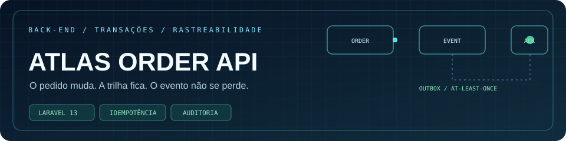

<p align="center"></p>

<p align="center"><a href="#rodar-localmente">Rodar</a> · <a href="#exemplo-de-chamada">Testar API</a> · <a href="#decisões-de-implementação">Arquitetura</a> · <a href="#testes-e-qualidade">Testes</a></p>

# Atlas Order API

API de pedidos em Laravel 13, com um painel local para acompanhar o fluxo. Construí este projeto para mostrar uma situação comum de back-end: a chamada pode chegar duas vezes, duas pessoas podem mudar o mesmo pedido ao mesmo tempo e, depois, alguém precisa entender quem alterou o quê.

O foco está nessas decisões, não em uma lista grande de endpoints.

## O que está pronto

- Criação de pedidos com `Idempotency-Key`. Repetir a mesma chamada devolve o mesmo pedido; reutilizar a chave com outro conteúdo retorna `409`.
- Fluxo de estados definido: `pending → approved → fulfilled`, com cancelamento antes da conclusão.
- Versão do pedido para evitar atualização concorrente silenciosa. Uma versão desatualizada retorna `409`.
- Histórico de cada mudança, com origem identificada no servidor, estado anterior e novo estado.
- Outbox transacional: cada evento de pedido gera uma mensagem interna sem dados pessoais, na mesma transação. O consumidor consulta pendências e confirma o processamento explicitamente.
- API protegida por token configurado fora do código. Sem token configurado, ela não aceita chamadas.
- Painel de leitura disponível apenas em ambiente `local`, com dados de demonstração sintéticos.
- Testes de API, formatação e CI.

```text
HTTP → token → validação → OrderService → orders
                                     ├──────→ order_events
                                     └──────→ outbox_messages → consumidor / ACK
```

## Rodar localmente

Requisitos: PHP 8.3+, Composer e extensão SQLite. Não precisa de conta em nuvem nem serviço pago.

```bash
composer install
cp .env.example .env
php artisan key:generate
php -r "touch('database/database.sqlite');"
php artisan migrate
php artisan db:seed --class=DemoOrderSeeder
php artisan serve
```

No Windows PowerShell, troque `cp` por `Copy-Item .env.example .env` caso o alias não esteja disponível. Antes de usar a API, defina `ATLAS_API_TOKEN` no `.env` com um valor aleatório; gere um com `php -r "echo bin2hex(random_bytes(24)), PHP_EOL;"`. Não commite esse valor. `ATLAS_API_CLIENT` identifica a aplicação chamadora no histórico.

Abra `http://127.0.0.1:8000` para ver o painel. O seeder pode rodar novamente sem duplicar pedidos.

## Exemplo de chamada

```bash
curl -X POST http://127.0.0.1:8000/api/orders \
  -H 'Accept: application/json' \
  -H 'Authorization: Bearer SEU_TOKEN_LOCAL' \
  -H 'Idempotency-Key: pedido-demo-001' \
  -H 'Content-Type: application/json' \
  -d '{"customer_name":"Maria Souza","customer_email":"maria@example.test","amount_cents":12500}'
```

Guarde o `id` e a `version` retornados. Para aprovar:

```bash
curl -X POST http://127.0.0.1:8000/api/orders/ID_DO_PEDIDO/transitions \
  -H 'Accept: application/json' \
  -H 'Authorization: Bearer SEU_TOKEN_LOCAL' \
  -H 'Content-Type: application/json' \
  -d '{"status":"approved","expected_version":1}'
```

| Método | Rota | Uso |
| --- | --- | --- |
| `GET` | `/api/orders` | Lista paginada; filtros exatos `status`, `customer_email`, valor mínimo/máximo em centavos e `per_page` (máximo 100) |
| `POST` | `/api/orders` | Cria pedido; exige `Idempotency-Key` |
| `GET` | `/api/orders/{id}` | Pedido e histórico |
| `POST` | `/api/orders/{id}/transitions` | Muda status com `expected_version` |
| `GET` | `/api/outbox` | Lista paginada; filtro `state=pending` ou `acked` |
| `POST` | `/api/outbox/{id}/ack` | Confirma uma mensagem após o consumidor processá-la |

## Decisões de implementação

A chave de idempotência tem restrição `UNIQUE` no banco. A consulta anterior à inserção melhora o caminho comum; a restrição cobre também a corrida entre requisições simultâneas. O hash do payload impede que a mesma chave seja reaproveitada para outro pedido.

As transições rodam em transação e usam bloqueio de linha quando o banco suporta. Pedido e evento são gravados juntos: não existe mudança de status sem registro correspondente. O campo `version` evita que um cliente atualize dados vistos antes de outra alteração. Estados finais não aceitam novas transições.

O identificador de quem chamou a API vem da configuração do servidor, não de um cabeçalho enviado pelo cliente. O painel não abre em produção e a API fica indisponível quando não há token configurado. Para um cenário com vários clientes, eu substituiria o token único por autenticação por cliente com rotação e permissões próprias.

O outbox evita o caso em que o pedido muda, mas a integração não sabe disso: pedido, auditoria e mensagem são gravados juntos. O payload contém só `event_id`, `order_id`, `status` e `version`. `order_event_id` é único; repetir uma criação idempotente não gera segunda mensagem. O endpoint de ACK é idempotente e mantém ator e horário do primeiro reconhecimento. **ACK não significa entrega a um cliente**: significa apenas que um consumidor externo confirmou seu próprio processamento. Esse consumidor deve deduplicar por `event_id`, pois pode reler a mesma mensagem antes do ACK. O projeto não envia webhooks por conta própria nem finge uma integração externa ativa.

## Testes e qualidade

```bash
php artisan test
vendor/bin/pint --test
```

Os testes cobrem autenticação, validação, repetição idempotente, conflito de payload, versão concorrente, transições inválidas, trilha de auditoria e criação/ACK do outbox sem dados pessoais. A suíte usa SQLite em memória; o painel usa SQLite em arquivo para a demonstração.

## Deploy e rollback

Em produção, configure `APP_ENV=production`, `APP_DEBUG=false`, `APP_KEY`, `ATLAS_API_TOKEN`, `ATLAS_API_CLIENT` e a conexão de banco por variáveis de ambiente. Use HTTPS e execute `php artisan migrate --force` antes de receber tráfego. O painel retorna `404` fora do ambiente local.

A segunda migração cria `outbox_messages` com FK para `order_events`, índice de pendências e unicidade por evento. Em uma base existente, faça backup e aplique `php artisan migrate --force` antes de liberar tráfego. `php artisan migrate:rollback --step=1` remove o outbox e **seus dados**; outro passo remove pedidos e eventos. Pare o consumidor e valide backup/restore em staging antes de qualquer rollback com dados reais. Este repositório não inclui credenciais nem dados de clientes.

---

<p align="center"><a href="https://github.com/LuisInacioDasilva"></a></p>
<p align="center"><strong>Desenvolvido por Luis da Silva</strong><br>Back-end, dados, integrações e automação em produção.</p>
